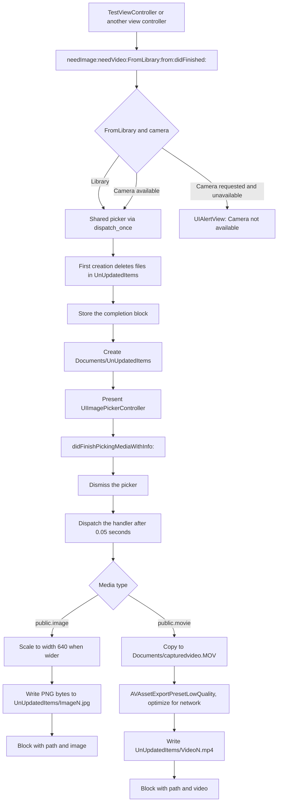
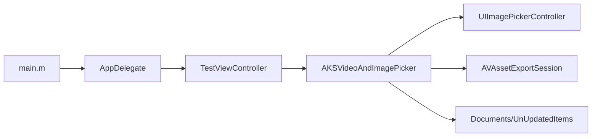

# AKSVideoAndImagePicker

[](https://github.com/aryansbtloe/AKSVideoAndImagePicker)
[](https://github.com/aryansbtloe/AKSVideoAndImagePicker)
[](LICENSE)

AKSVideoAndImagePicker is a block-based image and video picker with automatic optimisation of video and image for network use. The class wraps `UIImagePickerController`, presents either the camera or the Saved Photos album, scales a still wider than 640 points down to that width, and re-exports a movie with `AVAssetExportPresetLowQuality` and `shouldOptimizeForNetworkUse` enabled. When picking finishes, `AKSVideoAndImagePickerOperationFinishedBlock` receives the saved file path and a type string, `image` or `video`. The repository is one iOS application target that includes the picker and a sample view controller.

## Features

- One shared picker, created with `dispatch_once`, used by the class methods below.
- A single completion block, `AKSVideoAndImagePickerOperationFinishedBlock`, with the saved path and the type string.
- Image, video, or both, selected with `needImage:` and `needVideo:`. The picker `mediaTypes` are the strings `public.image` and `public.movie`.
- Library or camera, selected with `FromLibrary:`. `YES` uses `UIImagePickerControllerSourceTypeSavedPhotosAlbum`. `NO` uses `UIImagePickerControllerSourceTypeCamera`.
- Camera check: if the camera was requested and `isSourceTypeAvailable:` is false, the method shows a `UIAlertView` titled "Camera" with the message "Camera not available" and the button "Okay", then returns.
- Still images wider than 640 points are redrawn to that width, keeping aspect ratio. The bytes written are `UIImagePNGRepresentation` of that image.
- Video is copied to `Documents/capturedvideo.MOV`, then exported to the next free `Documents/UnUpdatedItems/VideoN.mp4`. The export session uses `AVAssetExportPresetLowQuality`, `AVFileTypeQuickTimeMovie`, and `shouldOptimizeForNetworkUse = YES`.
- The picker itself is configured with `UIImagePickerControllerQualityTypeLow` and `videoMaximumDuration` of 1800 seconds.
- Saved media is stored under `Documents/UnUpdatedItems/`, as `ImageN.jpg` and `VideoN.mp4`. The index starts at 0 and increases until the file name is unused.
- `resetCachedMediaFiles` deletes the files inside `Documents/UnUpdatedItems/`. The first time the shared picker is created, that method runs.
- The sample application installs `TestViewController` as the window root and, five seconds after `viewDidLoad`, opens the library for both image and video, then logs the path and type.

`showActivityIndicatorWithText:` and `removeActivityIndicator` are in the implementation. The first method only calls the second, and the second method is empty, so the strings "optimising video for network use" and "processing" are not shown on screen.

## Flow



The classes in the application target connect like this:



## Requirements

The Xcode project is the build definition in this repository.

| Setting | Value in the project |
| --- | --- |
| Language | Objective-C (`GCC_C_LANGUAGE_STANDARD` = `gnu99`) |
| Memory management | ARC (`CLANG_ENABLE_OBJC_ARC` = `YES`) |
| SDK | `iphoneos` |
| Deployment target | iOS 6.1 |
| Devices | iPhone and iPad (`TARGETED_DEVICE_FAMILY` = `1,2`) |
| Required device capability | `armv7` |
| Product | `AKSVideoAndImagePicker.app` |
| Bundle identifier | `com.kiplmobile24.${PRODUCT_NAME:rfc1034identifier}` |
| Version | `CFBundleShortVersionString` and `CFBundleVersion` are `1.0` |
| Project format | `objectVersion` 46, `compatibilityVersion` Xcode 3.2, `LastUpgradeCheck` 0460 |
| Code signing | `iPhone Developer` for `iphoneos` |

Linked frameworks, from the target Frameworks build phase:

- `UIKit.framework`
- `Foundation.framework`
- `CoreGraphics.framework`
- `AVFoundation.framework`

`AKSVideoAndImagePicker.m` also imports `QuartzCore/QuartzCore.h`. `QuartzCore.framework` is not listed in that Frameworks phase, and the implementation does not call a QuartzCore API.

`AKSVideoAndImagePicker-Info.plist` has no `NSCameraUsageDescription` and no `NSPhotoLibraryUsageDescription`. Orientations are portrait, landscape left, and landscape right on iPhone, plus portrait upside down on iPad. `LSRequiresIPhoneOS` is true. The development region is English, and `en.lproj/InfoPlist.strings` contains only the placeholder comment.

The prefix header, `AKSVideoAndImagePicker-Prefix.pch`, imports `UIKit` and `Foundation` for Objective-C files and warns when the iOS SDK is older than 3.0.

## Installation

Clone the repository and open the Xcode project:

```sh
git clone https://github.com/aryansbtloe/AKSVideoAndImagePicker.git
cd AKSVideoAndImagePicker
open AKSVideoAndImagePicker.xcodeproj
```

The project has one application target, `AKSVideoAndImagePicker`. A scheme with that name is stored at `AKSVideoAndImagePicker.xcodeproj/xcuserdata/alok.xcuserdatad/xcschemes/AKSVideoAndImagePicker.xcscheme`. Its launch, profile, and archive actions build that target. The scheme's test action has an empty testables list.

There is no `Podfile`, `Cartfile`, `Package.swift`, or other package manifest in the repository. The picker ships as the source files `AKSVideoAndImagePicker.h` and `AKSVideoAndImagePicker.m` compiled into the application target.

## Usage

The public interface is the block typedef and two class methods in `AKSVideoAndImagePicker.h`:

```objc
typedef void (^AKSVideoAndImagePickerOperationFinishedBlock)(NSString *filePath, NSString *fileType);

+ (void)needImage:(BOOL)imageNeeded needVideo:(BOOL)videoNeeded FromLibrary:(BOOL)fromLibrary from:(UIViewController *)viewController didFinished:(AKSVideoAndImagePickerOperationFinishedBlock)operationFinishedBlock;
+ (void)resetCachedMediaFiles;
```

`fileType` is the string `image` after a still is written, and the string `video` after the export handler runs. The block is stored on the shared instance, so a later call replaces the previous block. `FromLibrary:YES` selects the Saved Photos album, as the sample does. `FromLibrary:NO` selects the camera. `needImage:` and `needVideo:` each add one entry to `mediaTypes` when they are true.

The sample in `TestViewController.m` waits five seconds, then asks for an image and a video from the library and logs both callback arguments:

```objc
#import "AKSVideoAndImagePicker.h"

- (void)viewDidLoad{
    [super viewDidLoad];
	double delayInSeconds = 5.0;
	dispatch_time_t popTime = dispatch_time(DISPATCH_TIME_NOW, (int64_t)(delayInSeconds * NSEC_PER_SEC));
	dispatch_after(popTime, dispatch_get_main_queue(), ^(void){
		[AKSVideoAndImagePicker needImage:TRUE needVideo:TRUE FromLibrary:YES from:self didFinished:^(NSString *filePath, NSString *fileType) {
			NSLog(@"%@",filePath);
			NSLog(@"%@",fileType);
		}];
	});
}
```

`AppDelegate` creates the window and sets that controller as the root:

```objc
self.window = [[UIWindow alloc] initWithFrame:[[UIScreen mainScreen] bounds]];
[self.window setRootViewController:[[TestViewController alloc]init]];
[self.window makeKeyAndVisible];
```

The shared picker calls the other public method the first time it is created:

```objc
[AKSVideoAndImagePicker resetCachedMediaFiles];
```

On a successful image pick, `filePath` looks like `Documents/UnUpdatedItems/Image0.jpg`. The file contents are PNG data. On a video pick, `filePath` looks like `Documents/UnUpdatedItems/Video0.mp4`. The export file type is `AVFileTypeQuickTimeMovie`. The export completion path calls the block from `compressionSuccessFull` and does not read `AVAssetExportSession.status`.

`imagePickerController:didFinishPickingMediaWithInfo:` dismisses the controller and sets `imagePickerController` to nil. `imagePickerControllerDidCancel:` is not implemented.

The first call that creates the shared picker also runs `resetCachedMediaFiles`, which removes whatever is already in `Documents/UnUpdatedItems/`.

## Project structure

```
.
├── LICENSE
├── README.md
├── AKSVideoAndImagePicker.xcodeproj
│   ├── project.pbxproj
│   ├── project.xcworkspace
│   └── xcuserdata/alok.xcuserdatad/xcschemes/AKSVideoAndImagePicker.xcscheme
└── AKSVideoAndImagePicker
    ├── AKSVideoAndImagePicker.h          Public picker interface
    ├── AKSVideoAndImagePicker.m          Picker, compression, and file output
    ├── AppDelegate.h
    ├── AppDelegate.m                     Window and root view controller
    ├── TestViewController.h
    ├── TestViewController.m              Sample call into the picker
    ├── main.m
    ├── AKSVideoAndImagePicker-Info.plist
    ├── AKSVideoAndImagePicker-Prefix.pch
    ├── en.lproj/InfoPlist.strings
    ├── Default.png                       320×480 launch image
    ├── Default@2x.png                    640×960 launch image
    └── Default-568h@2x.png               640×1136 launch image
```

In the Xcode group tree, `AKSVideoAndImagePicker.h` and `AKSVideoAndImagePicker.m` sit on the project group. On disk they live in the `AKSVideoAndImagePicker` directory. Some file headers still use older names: the picker files say `Betify`, and `TestViewController` says `BlockBasedImagePicker`. The target and product name is `AKSVideoAndImagePicker`.

## Customisation

There is no settings plist, environment file, or preprocessor flag for the picker. The values below are compiled into `AKSVideoAndImagePicker.m`.

| Behaviour | Where it is set | Current value |
| --- | --- | --- |
| Still-image width cap | `compressThisImage:` | 640 points, only when `image.size.width` is greater than 640 |
| Picker video quality | `needImage:needVideo:FromLibrary:from:didFinished:` | `UIImagePickerControllerQualityTypeLow` |
| Maximum recording length | same method | 1800 seconds |
| Library source | same method, when `fromLibrary` is true | `UIImagePickerControllerSourceTypeSavedPhotosAlbum` |
| Camera source | same method, when `fromLibrary` is false | `UIImagePickerControllerSourceTypeCamera` |
| Accepted media | same method | `public.movie` when video is needed, `public.image` when an image is needed |
| Video export preset | `convertVideoToLowQuailtyWithInputURL:outputURL:handler:` | `AVAssetExportPresetLowQuality` |
| Export file type | same method | `AVFileTypeQuickTimeMovie` |
| Network optimisation flag | same method | `shouldOptimizeForNetworkUse = YES` |
| Temporary movie | `getTemporaryFilePathToSaveVideo` | `Documents/capturedvideo.MOV` |
| Final movie name | `getFilePathToSaveUnUpdatedVideo` | `Documents/UnUpdatedItems/VideoN.mp4` |
| Final still name | `getFilePathToSaveUnUpdatedImage` | `Documents/UnUpdatedItems/ImageN.jpg` |
| Cache directory | `documentsDirectory` plus `UnUpdatedItems` | created before the picker is presented |
| Finish delay | `imagePickerController:didFinishPickingMediaWithInfo:` | 0.05 seconds |
| Sample delay | `TestViewController` `viewDidLoad` | 5.0 seconds |

Application settings that are in the project rather than in the picker:

- Debug defines `DEBUG=1`, sets optimisation to 0, and builds only the active architecture.
- Release adds `OTHER_CFLAGS` = `-DNS_BLOCK_ASSERTIONS=1`, strips the copy phase, and sets `VALIDATE_PRODUCT` = `YES`.
- The Info.plist values listed under Requirements control the bundle identifier, version, device capability, and supported orientations.

Changing a limit means editing that source value and rebuilding the `AKSVideoAndImagePicker` target.

## Contributing

Issues and pull requests go to [aryansbtloe/AKSVideoAndImagePicker](https://github.com/aryansbtloe/AKSVideoAndImagePicker). The default branch is `master`.

1. Fork the repository and branch from `master`.
2. The public surface is the two class methods in `AKSVideoAndImagePicker.h`. Describe any change to that surface in the pull request.
3. Build and run the `AKSVideoAndImagePicker` target. The checked-in scheme has no test target and the repository has no test sources, so the sample controller is the exercise path: it presents the library picker and logs `filePath` and `fileType`.
4. Open a pull request against `master` describing the behaviour you changed.

Leave the existing per-file copyright headers in place. See the license section for what those headers say.

## License

The [MIT License](LICENSE) in this repository covers Alok Singh's own code:

```
Copyright (c) 2026 Alok Singh
```

Each Objective-C source file still carries its original header, and those headers were left as they are:

```
Copyright (c) 2013 Konstant Info Private Limited. All rights reserved.
```

The project organisation name in `project.pbxproj` is Konstant Info Private Limited. This tree has no vendored third-party source and no second license file. `UIKit`, `Foundation`, `CoreGraphics`, `AVFoundation`, and the imported `QuartzCore` headers are Apple system frameworks and stay under Apple's terms. The MIT license applies to Alok Singh's own code. The 2013 file headers stay in the source.

## Author

Alok Singh

- GitHub: [https://github.com/aryansbtloe](https://github.com/aryansbtloe)
- Website: [https://bestlatestapps.com](https://bestlatestapps.com)

The picker and sample were created by Alok. The file headers are dated 17 June 2013 for `AKSVideoAndImagePicker` and 27 August 2013 for the application sources.
